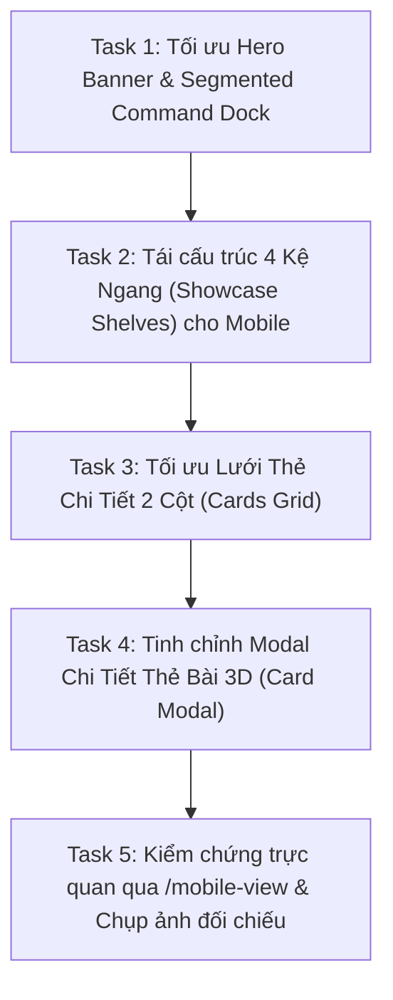

# Tối Ưu Giao Diện Thư Viện Thẻ Bài (Cards View) Trên Mobile

Giao diện Thư Viện Thẻ Bài (`#cardsView`) trên Mobile (`<= 700px`) hiện đang gặp các hạn chế nghiêm trọng về bố cục responsive do kế thừa tỉ lệ cố định của Desktop (đặc biệt là tỉ lệ dẹp `aspect-ratio: 2172 / 724` của 4 kệ ngang khiến thẻ bài bị co rúm như tem thư, mascot đè lên chữ, hero banner bị ép dẹp, grid xem riêng lẻ chiếm toàn màn hình cuộn mỏi tay, và card modal bị co cụm mờ nét). Kế hoạch này tối ưu toàn diện phần Thẻ Bài trên Mobile theo phong cách **3D Toy / Sunlit Boardgame Aesthetic**, bảo đảm Desktop (`> 700px`) giữ nguyên 100%.

---

## Danh Sách Task Triển Khai

### Task 1: Tối ưu Hero Banner & Segmented Command Dock (`<= 700px`)
- **Tệp sửa đổi:** `mobile-home.css`
- **Mục tiêu:**
  - Nâng chiều cao `.cards-hero-banner` trên mobile thành `min-height: 250px` với padding top hợp lý để không bị Header đè lên.
  - Điều chỉnh `.cards-hero-helm-badge`, tiêu đề 3D `THẺ BÀI LOGISQUEST` to rõ nét, có độ sâu chữ nổi và không bị đè chữ.
  - Tinh chỉnh `.cards-capsule-command-dock` và `.capsule-filter-group`: Bo cong mềm mại, touch target tối thiểu `40px`, thanh cuộn ngang mượt mà có scroll snap nhẹ, active state với bóng đổ 3D rực rỡ theo từng màu đặc trưng của 4 loại thẻ (Cam, Xanh dương, Xanh ngọc, Đỏ).

### Task 2: Tái cấu trúc 4 Kệ Trưng Bày Ngang (`.showcase-shelf`) cho Mobile
- **Tệp sửa đổi:** `mobile-home.css`, `app.js` (nếu cần tinh chỉnh class hoặc indicator).
- **Mục tiêu:**
  - Hủy bỏ `aspect-ratio: 2172 / 724` cố định trên mobile; chuyển `.showcase-shelf` sang layout dọc 2 tầng (`flex-direction: column`):
    - **Tầng trên (Shelf Header)**: Căn chỉnh tiêu đề nhóm thẻ, mô tả ngắn gọn và Mascot 3D đặt gọn gàng một góc với kích thước tương xứng (`width: ~95px - 110px`), hiệu ứng đổ bóng nổi, không che chữ.
    - **Tầng dưới (Cards Carousel Track)**: Băng chuyền cuộn ngang mượt mà (`scroll-snap-type: x mandatory`).
  - Phóng to kích thước thẻ bài (`.tabbed-card-item`) trên mobile lên chiều rộng `135px - 142px` (thay vì 124px bị bẹp dí), giữ nguyên tỉ lệ thẻ chuẩn, hiển thị artwork sắc nét, nhãn tên thẻ rõ ràng 1-2 dòng không bị cắt mất chữ.
  - Giữ các chấm pagination indicator hoặc mũi tên chạm lướt dễ dàng.

### Task 3: Tối ưu Lưới Thẻ Chi Tiết Khi Lọc Riêng (`.cards-grid`)
- **Tệp sửa đổi:** `mobile-home.css`, `app.js`.
- **Mục tiêu:**
  - Thiết kế lại header của Grid (`#cardsGridHeader`): Nút "Quay Lại Tất Cả Kệ" dạng nút 3D Toy dễ bấm bằng ngón tay cái, mascot nhỏ gọn.
  - Chuyển `#cardsGrid` từ 1 cột dài ngoằng sang **Lưới 2 Cột Cân Đối (`grid-template-columns: repeat(2, 1fr)`)** chuẩn game collection:
    - Ảnh thẻ bài chiếm phần lớn khung thẻ, bo góc đồ chơi tinh tế.
    - Tên thẻ in đậm rõ nét, badge phân loại nhỏ nhắn.
    - Hiệu ứng chạm bấm phản hồi nảy 3D (`active: scale(0.97)`).

### Task 4: Tinh chỉnh Modal Chi Tiết Thẻ Bài 3D (`#cardModal`)
- **Tệp sửa đổi:** `mobile-home.css`, `mobile-redesign.css`.
- **Mục tiêu:**
  - Loại bỏ hoàn toàn `zoom: 0.6` gây mờ nét font chữ; sử dụng `transform: scale(0.85)` hoặc kích thước pixel trực tiếp sắc nét.
  - Bố trí modal cuộn dọc mượt mà (`max-height: 88vh`, `overflow-y: auto`), bo tròn góc 28px, nút đóng tròn nổi bật ở góc trên.
  - Tab "Quy tắc cốt lõi" và "Chiến thuật đỉnh cao" dễ dàng chuyển đổi chỉ với 1 chạm.
  - Băng chuyền thẻ con ở chân modal (`modal-subcards-section`) nằm cách đáy một khoảng an toàn (`padding-bottom: 24px`) để không bị thanh điều hướng trình duyệt điện thoại che khuất.

### Task 5: Kiểm chứng trực quan qua `/mobile-view` & Đánh giá
- **Công cụ:** Playwright runner qua `/mobile-view` chụp lại toàn bộ các trạng thái:
  1. `cards-1-hero-dock-fixed.png`: Hero Banner + Command Dock.
  2. `cards-2-shelves-fixed.png`: Kệ ngang đã chuyển thành layout dọc sắc nét, thẻ bài to rõ.
  3. `cards-3-grid-fixed.png`: Lưới 2 cột khi chọn danh mục Incoterms.
  4. `cards-4-modal-fixed.png`: Modal chi tiết 3D sắc nét, không bị che chân trang.
- Xác nhận desktop (`> 700px`) hoàn toàn không bị ảnh hưởng.
