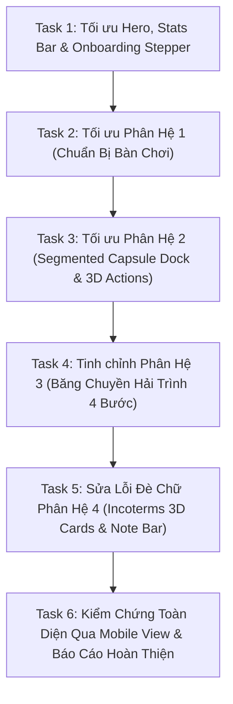

# Kế Hoạch Tối Ưu Giao Diện Cách Chơi (Gameplay View) Trên Mobile

Tài liệu này xác định kế hoạch tái thiết kế và tối ưu toàn diện giao diện **Cách Chơi (`#gameplayView`)** trên Mobile (`<= 700px`) theo ngôn ngữ **3D Toy / Sunlit Boardgame Aesthetic**, bảo đảm giao diện Desktop (`> 700px`) giữ nguyên **100% không bị ảnh hưởng**.

---

## 1. Phân Tích Hiện Trạng & Mục Tiêu

### Hiện trạng phát hiện qua Mobile View:
1. **Hero & Stats Bar (`.gp-hero`, `.gp-stats-bar`, `.gp-stepper`)**:
   - Tiêu đề chữ bị dính sát mép, stats bar 2 cột để trống ô thứ 4 gây mất cân đối.
   - Stepper 4 bước thiếu hiệu ứng scroll mượt có trừ hao Header 64px, khiến tiêu đề phân hệ bị che khi bấm vào bước.
2. **Phân hệ 1: Chuẩn bị bàn chơi (`#gpSetup`)**:
   - Chưa có `scroll-margin-top: 72px`, 3 thẻ bước có chiều cao cọc cạch và padding chưa tối ưu cho cảm ứng.
3. **Phân hệ 2: Ba hành động trong lượt (`#gpActions`)**:
   - 3 Tab chọn hành động xếp dọc dài ngoằng; khi bấm tab thì ảnh 3D và nội dung ở xa phía dưới, không thấy phản hồi tức thì. Cần chuyển thành **Segmented Capsule Bar ngang** gắn liền phía trên ảnh 3D.
4. **Phân hệ 3: Quy trình cập cảng 4 bước (`#gpFlow`)**:
   - Băng chuyền 4 bước cần làm đẹp khung thẻ 3D Toy, chấm phân trang cần tăng diện tích chạm (hit area).
5. **Phân hệ 4: Cơ chế tính điểm Incoterms (`#gpIncoterms`)**:
   - **Lỗi nghiêm trọng:** Ảnh 3D (`.gp-matrix-img`) tràn ra ngoài khung `height: 110px`, đè lấp lên toàn bộ bullet text bên dưới khiến nội dung không thể đọc được.
   - Cần cố định khung ảnh 3D `height: 115px`, `object-fit: contain`, bullet text nằm riêng biệt bên dưới với viền màu chuẩn 4 nhóm (E: Xanh lục, F: Xanh dương, C: Vàng cam, D: Đỏ san hô).
   - Khung "Lưu ý quan trọng" thiếu đệm đáy an toàn (cần `margin-bottom: 84px`).

---

## 2. Danh Sách Task Triển Khai

### Task 1: Tối ưu Hero Banner, Stats Bar & Stepper (`.gp-hero`, `.gp-stats-bar`, `.gp-stepper`)
- **Tệp sửa đổi:** `mobile-redesign.css`
- **Mục tiêu:**
  - Nâng `padding-top: 74px !important;` cho `.gp-hero` để không bị Header đè lên.
  - Cân đối `.gp-stats-bar`: Chuyển sang bố cục 4 thẻ cân xứng hoặc lưới 2 cột gọn gàng với `gp-stat-goal` chiếm toàn bộ chiều rộng hàng cuối cùng một cách thanh lịch.
  - Tối ưu `.gp-stepper`: Dạng viên thuốc 3D Toy nổi bật, touch target tối thiểu 40px, gắn logic cuộn mượt trừ hao header `scroll-margin-top`.

### Task 2: Tối ưu Phân Hệ 1 — Chuẩn Bị Bàn Chơi (`#gpSetup`)
- **Tệp sửa đổi:** `mobile-redesign.css`
- **Mục tiêu:**
  - Thêm `scroll-margin-top: 72px !important;` để không bị Header che khi điều hướng.
  - Căn chỉnh `.gp-setup-col-media`: Khung ảnh bàn cờ 3D bo góc 20px, bóng đổ đồ chơi nhẹ.
  - Chuẩn hóa 3 thẻ bước (`.gp-setup-step-item`): Chiều cao bằng nhau, icon bo tròn đồ chơi, số thứ tự `01`, `02`, `03` nổi khối, typography rõ nét.

### Task 3: Tối ưu Phân Hệ 2 — Ba Hành Động Trong Lượt (`#gpActions`)
- **Tệp sửa đổi:** `mobile-redesign.css`, `mobile-redesign.js` (hoặc `app.js`)
- **Mục tiêu:**
  - Chuyển `.gp-action-tabs-list` từ dạng 3 hàng dọc sang **Segmented Capsule Dock ngang** (`display: flex; gap: 6px; overflow-x: auto; padding: 4px;`):
    - 3 Tab viên thuốc dạng 3D Toy: `01 Nạp Hàng`, `02 Xếp Tàu`, `03 Cập Cảng`.
    - Tab active nổi bật với màu cam rực rỡ và bóng đổ khối.
  - Khung ảnh 3D nằm ngay bên dưới thanh dock, thay đổi hình ảnh tức thì khi chạm tab.
  - Panel chi tiết hành động và khung `Mẹo chiến lược` nằm gọn gàng bên dưới ảnh, không bị tràn cuộn dài.

### Task 4: Tinh chỉnh Phân Hệ 3 — Hải Trình Bốn Bước (`#gpFlow`)
- **Tệp sửa đổi:** `mobile-redesign.css`, `mobile-redesign.js`
- **Mục tiêu:**
  - Bổ sung `scroll-margin-top: 72px !important;`.
  - Khung thẻ `.gp-timeline-step-card`: Bo góc 22px, nền trắng kem viền xanh đại dương `#BAE6FD`, bóng đổ nổi 3D.
  - Icon bước to rõ, tiêu đề in đậm, mô tả dễ đọc.
  - Tăng kích thước chấm `.gp-flow-dot` lên `8px x 8px` (active: `24px x 8px`) với vùng chạm cảm ứng `::before`.

### Task 5: Sửa Lỗi Đè Chữ Phân Hệ 4 — Cơ Chế Tính Điểm Incoterms (`#gpIncoterms`)
- **Tệp sửa đổi:** `mobile-redesign.css`
- **Mục tiêu:**
  - **Khắc phục triệt để lỗi ảnh đè lên chữ**:
    - Thiết lập `.gp-matrix-thumb { height: 115px !important; width: 100% !important; overflow: hidden !important; display: flex !important; justify-content: center !important; }`
    - Thiết lập `.gp-matrix-img { max-height: 110px !important; width: auto !important; height: auto !important; object-fit: contain !important; }`
    - Thiết lập `.gp-matrix-bullets { margin-top: 12px !important; position: static !important; }`
  - Đồng bộ viền 4 nhóm Incoterms theo màu đặc trưng:
    - Nhóm E: Viền xanh ngọc `#A7F3D0`, icon ngọc.
    - Nhóm F: Viền xanh dương `#BAE6FD`, icon biển.
    - Nhóm C: Viền vàng hổ phách `#FDE68A`, icon vàng.
    - Nhóm D: Viền hồng san hô `#FECDD3`, icon đỏ.
  - Tăng khoảng đệm đáy cho `.gp-important-note-bar` lên `margin-bottom: 84px !important;`.

### Task 6: Kiểm Chứng Toàn Diện Qua Mobile View Simulator & Xác Minh Desktop
- **Công cụ:** Playwright runner qua `/mobile-view`.
- **Kiểm tra:**
  1. Chụp ảnh màn hình từng phân hệ bằng khung iPhone chân thực.
  2. Xác minh không còn bất kỳ hiện tượng đè chữ, tràn lề hoặc che khuất nào.
  3. Kiểm tra tự động trên màn hình Desktop `1440x900` bảo đảm không có hồi quy.
  4. Cập nhật `walkthrough.md` và xuất `<!-- GOAL_COMPLETE -->`.
